# 📊 opencode-copilot-statusline

[](https://www.npmjs.com/package/opencode-copilot-statusline)
[](https://github.com/lnwu/opencode-statusline-plugins/blob/main/packages/opencode-copilot-statusline/LICENSE)

[English](https://github.com/lnwu/opencode-statusline-plugins/blob/main/packages/opencode-copilot-statusline/README.md) | **简体中文**

在 OpenCode TUI 底栏显示 GitHub Copilot 配额。



## ✨ 功能

- 在输入框底栏实时显示配额已用百分比（`Copilot 87%`）
- 终端宽度 ≥ 120 列时显示每月重置倒计时；< 80 列时隐藏账号标签
- 颜色提示：`Copilot` 标签与百分比同色；正常为弱化色，≥ 70% 为警告色，≥ 90% 或无法解析配额时为错误色
- 有多个带 OpenCode 凭据标签的 GitHub Copilot 登录时，显示当前登录的凭据标签，首字母大写，最多 16 个字符（`Copilot · Work 87%`）
- 仅当会话模型的提供方（provider）为 `github-copilot` 时显示
- 配额约每分钟自动刷新一次

## 📋 环境要求

- OpenCode 2.0.0 之后的版本
- 已在 OpenCode 登录 GitHub Copilot 账号，任意计划均可，包括 Copilot Free（`opencode auth login github-copilot`）

## 🚀 安装

```sh
opencode plugin add opencode-copilot-statusline
```

## 📈 百分比的含义

底栏显示 premium requests；没有 premium requests 配额的计划改为显示 chat 额度：

| 情况                                                                                   | 来源                            | 示例          |
| -------------------------------------------------------------------------------------- | ------------------------------- | ------------- |
| 有 premium requests 配额的计划                                                         | 本月已用的 **premium requests** | `Copilot 87%` |
| Copilot Free（没有 premium requests 配额）                                             | **chat** 额度                   | `Copilot 6%`  |
| 当前显示的配额报告为无限                                                               | 没有有限配额                    | `Copilot ∞`   |
| 尚未成功获取：首次获取进行中、未登录、凭据无法解析或被拒绝、接口无法访问或返回意外响应 | 无数据                          | `Copilot —`   |

倒计时指向每月配额重置日期。成功获取一次后，之后的获取失败时底栏会保留该账号上一次的数值；切换到尚无数据的账号时显示 `Copilot —`。

## 🩺 疑难排查

- **底栏始终不显示**：仅当会话模型的提供方为 `github-copilot` 时才显示。请先在会话中切换到 GitHub Copilot 模型。
- **只显示 `Copilot —` 而没有数字**：还没有成功获取过配额。可能是首次获取仍在进行、`github-copilot` 凭据无法解析或被拒绝、接口无法访问或返回了意外的响应，或服务端插件未加载。请运行 `opencode auth login github-copilot`，然后等待最多一分钟的下次刷新。如果仍未恢复，确认 OpenCode 配置（`opencode.json` 或 `opencode.jsonc`）的 `plugins` 中仍有 `opencode-copilot-statusline`。
- **显示 `Copilot ∞`**：当前显示的配额（premium requests，没有该配额时为 chat）报告为无限。

## 📜 变更日志

完整发布历史见 [CHANGELOG.zh-CN.md](https://github.com/lnwu/opencode-statusline-plugins/blob/main/packages/opencode-copilot-statusline/CHANGELOG.zh-CN.md)。

## 📄 许可证

MIT
