# 📊 opencode-go-statusline

[](https://www.npmjs.com/package/opencode-go-statusline)
[](https://github.com/lnwu/opencode-statusline-plugins/blob/main/packages/opencode-go-statusline/LICENSE)

**English** | [简体中文](https://github.com/lnwu/opencode-statusline-plugins/blob/main/packages/opencode-go-statusline/README.zh-CN.md)

Display your OpenCode Go subscription quota in the TUI footer statusline.



## ✨ Features

- Live **rolling 5h / weekly / monthly** usage percentages in the prompt footer
- Reset countdowns on terminals 120 columns or wider; 80–119 columns use short labels (`5H`, `W`, `M`), and narrower terminals show the weekly window only
- Color feedback: subdued normally, warning at ≥70%, error at ≥90% or when a quota window reports a non-`ok` status
- Only appears for sessions whose model provider is `opencode-go`
- Usage refreshes about once per minute
- Labels follow your terminal locale (`5h / Weekly / Monthly` or `5h / 周 / 月`), overridable with the `language` option

## 📋 Requirements

- OpenCode newer than 2.0.0
- An OpenCode Go API key connected in OpenCode (`opencode-go`)

## 🚀 Install

```sh
opencode plugin add opencode-go-statusline
```

## 🌐 Language

Labels follow your terminal locale by default: `zh*` locales show `5h / 周 / 月`, everything else shows `5h / Weekly / Monthly`.

Override it with the plugin's `language` option in the OpenCode config (`opencode.json` or `opencode.jsonc`):

```jsonc title="~/.config/opencode/opencode.jsonc"
{
  "plugins": [
    { "package": "opencode-go-statusline", "options": { "language": "zh-CN" } },
  ],
}
```

| Value              | Display                                                 |
| ------------------ | ------------------------------------------------------- |
| `"auto"` (default) | Detect from `LC_ALL`, `LC_MESSAGES`, `LANGUAGE`, `LANG` |
| `"en"`             | `5h / Weekly / Monthly`                                 |
| `"zh-CN"` / `"zh"` | `5h / 周 / 月`                                          |

A `language` set for the plugin in `cli.json` takes precedence over the one in `opencode.json`.

## 🩺 Troubleshooting

- **The statusline never shows up** — it is hidden unless the session's model provider is `opencode-go`. Switch to an OpenCode Go model in the session.
- **It shows `Go —` instead of numbers** — no usage fetch has succeeded yet: the first fetch is still running, the `opencode-go` API key could not be resolved or was rejected, the usage API could not be reached or returned an unexpected response, or the server plugin is disabled. Connect the key with `opencode auth login opencode-go` and wait up to a minute for the next refresh. If it persists, check that `opencode-go-statusline` is still listed under `plugins` in the OpenCode config (`opencode.json` or `opencode.jsonc`). After one successful fetch, the statusline keeps the last values when a later fetch fails.

## 📜 Changelog

See [CHANGELOG.md](https://github.com/lnwu/opencode-statusline-plugins/blob/main/packages/opencode-go-statusline/CHANGELOG.md) for the release history.

## 📄 License

MIT
