# 📊 opencode-go-statusline

[](https://www.npmjs.com/package/opencode-go-statusline)
[](https://github.com/lnwu/opencode-statusline-plugins/blob/main/packages/opencode-go-statusline/LICENSE)

[English](https://github.com/lnwu/opencode-statusline-plugins/blob/main/packages/opencode-go-statusline/README.md) | **简体中文**

在 OpenCode TUI 底栏显示 OpenCode Go 订阅配额。



## ✨ 功能

- 在输入框底栏实时显示 **滚动 5 小时 / 每周 / 每月** 配额的已用百分比
- 终端宽度 ≥ 120 列时显示重置倒计时；80 至 119 列使用短标签（`5H`、`周`、`月`），更窄时只显示每周窗口
- 颜色提示：正常为弱化色，≥ 70% 变警告色，≥ 90% 或配额窗口报告的状态不是 `ok` 时变错误色
- 仅当会话模型的提供方（provider）为 `opencode-go` 时显示
- 配额约每分钟自动刷新一次
- 标签跟随终端语言（`5h / 周 / 月` 或 `5h / Weekly / Monthly`），可用 `language` 选项覆盖

## 📋 环境要求

- OpenCode 2.0.0 之后的版本
- 已在 OpenCode 中连接 OpenCode Go API 密钥（`opencode-go`）

## 🚀 安装

```sh
opencode plugin add opencode-go-statusline
```

## 🌐 语言

底栏标签默认跟随终端语言环境：`zh*` 语言环境显示 `5h / 周 / 月`，其他显示 `5h / Weekly / Monthly`。

可在 OpenCode 配置（`opencode.json` 或 `opencode.jsonc`）中用 `language` 选项覆盖：

```jsonc title="~/.config/opencode/opencode.jsonc"
{
  "plugins": [
    { "package": "opencode-go-statusline", "options": { "language": "zh-CN" } },
  ],
}
```

| 取值               | 显示                                                    |
| ------------------ | ------------------------------------------------------- |
| `"auto"`（默认）   | 按 `LC_ALL`、`LC_MESSAGES`、`LANGUAGE`、`LANG` 自动判断 |
| `"en"`             | `5h / Weekly / Monthly`                                 |
| `"zh-CN"` / `"zh"` | `5h / 周 / 月`                                          |

如果在 `cli.json` 中也为插件设置了 `language`，以 `cli.json` 中的值为准。

## 🩺 疑难排查

- **底栏始终不显示**：仅当会话模型的提供方为 `opencode-go` 时才显示。请先在会话中切换到 OpenCode Go 模型。
- **只显示 `Go —` 而没有数字**：还没有成功获取过配额。可能是首次获取仍在进行、`opencode-go` API 密钥无法解析或被拒绝、配额接口无法访问或返回了意外的响应，或服务端插件被禁用。请用 `opencode auth login opencode-go` 连接密钥，然后等待最多一分钟的下次刷新。如果仍未恢复，确认 OpenCode 配置（`opencode.json` 或 `opencode.jsonc`）的 `plugins` 中仍有 `opencode-go-statusline`。成功获取一次后，之后的获取失败时底栏会保留上一次的数值。

## 📜 变更日志

完整发布历史见 [CHANGELOG.zh-CN.md](https://github.com/lnwu/opencode-statusline-plugins/blob/main/packages/opencode-go-statusline/CHANGELOG.zh-CN.md)。

## 📄 许可证

MIT
