# 📊 opencode-kimi-code-statusline

[](https://www.npmjs.com/package/opencode-kimi-code-statusline)
[](https://github.com/lnwu/opencode-statusline-plugins/blob/main/packages/opencode-kimi-code-statusline/LICENSE)

**English** | [简体中文](https://github.com/lnwu/opencode-statusline-plugins/blob/main/packages/opencode-kimi-code-statusline/README.zh-CN.md)

Display your Kimi For Coding (Kimi Code) subscription quota in the OpenCode TUI footer statusline.



## ✨ Features

- Live **rolling 5h / weekly** usage percentages in the prompt footer (`Kimi 5h 63% · Weekly 18%`)
- Reset countdowns on terminals 120 columns or wider; 80–119 columns use short labels (`5H`, `W`), and narrower terminals show the weekly window only
- Color feedback on each segment: subdued normally, warning at ≥70%, error at ≥90%
- Only appears for sessions whose model provider is `kimi-code-plan-global` or `kimi-code-plan-cn`
- Usage refreshes about once per minute
- Labels follow your terminal locale (`5h / Weekly` or `5h / 周`), overridable with the `language` option

## 📋 Requirements

- OpenCode newer than 2.0.0
- An active Kimi For Coding subscription connected to OpenCode (`opencode auth login kimi-code-plan-global`, or `kimi-code-plan-cn` for the China plan)

## 🚀 Install

```sh
opencode plugin add opencode-kimi-code-statusline
```

## 🌐 Language

Labels follow your terminal locale by default: `zh*` locales show `5h / 周`, everything else shows `5h / Weekly`.

Override it with the plugin's `language` option in the OpenCode config (`opencode.json` or `opencode.jsonc`):

```jsonc title="~/.config/opencode/opencode.jsonc"
{
  "plugins": [
    {
      "package": "opencode-kimi-code-statusline",
      "options": { "language": "zh-CN" },
    },
  ],
}
```

| Value              | Display                                                 |
| ------------------ | ------------------------------------------------------- |
| `"auto"` (default) | Detect from `LC_ALL`, `LC_MESSAGES`, `LANGUAGE`, `LANG` |
| `"en"`             | `5h / Weekly`                                           |
| `"zh-CN"` / `"zh"` | `5h / 周`                                               |

A `language` set for the plugin in `cli.json` takes precedence over the one in `opencode.json`.

## 📈 What the percentages mean

| Case                                                                                                                                                            | Example      |
| --------------------------------------------------------------------------------------------------------------------------------------------------------------- | ------------ |
| Rolling 5-hour                                                                                                                                                  | `5h 63%`     |
| Weekly                                                                                                                                                          | `Weekly 18%` |
| No successful fetch yet for the session's plan: first fetch running, not signed in, credential unresolvable or rejected, API unreachable or unexpected response | `Kimi —`     |

Both percentages are **used** percentages of their own window, and each countdown targets that window's reset time. After one successful fetch, the statusline keeps the last values when a later fetch fails.

## 🩺 Troubleshooting

- **The statusline never shows up** — it is hidden unless the session's model provider is `kimi-code-plan-global` or `kimi-code-plan-cn`. Switch to a Kimi For Coding model in the session.
- **It shows `Kimi —` instead of numbers** — no quota fetch has succeeded yet for the session's plan: the first fetch is still running, its credential could not be resolved or was rejected, its API could not be reached or returned an unexpected response, or the server plugin is disabled. Log in to the plan the session's model uses (`opencode auth login kimi-code-plan-global`, or `kimi-code-plan-cn` for the China plan) and wait up to a minute for the next refresh. If it persists, check that `opencode-kimi-code-statusline` is still listed under `plugins` in the OpenCode config (`opencode.json` or `opencode.jsonc`).
- **Global vs. China plan** — `kimi-code-plan-global` is the global plan (`api.kimi.ai`); `kimi-code-plan-cn` is the China plan (`api.kimi.com`). The statusline shows the quota of the plan the current session uses, so connect that plan's credential.

## 📜 Changelog

See [CHANGELOG.md](https://github.com/lnwu/opencode-statusline-plugins/blob/main/packages/opencode-kimi-code-statusline/CHANGELOG.md) for the release history.

## 📄 License

MIT
