# 📊 opencode-kimi-code-statusline

[](https://www.npmjs.com/package/opencode-kimi-code-statusline)
[](https://github.com/lnwu/opencode-statusline-plugins/blob/main/packages/opencode-kimi-code-statusline/LICENSE)

[English](https://github.com/lnwu/opencode-statusline-plugins/blob/main/packages/opencode-kimi-code-statusline/README.md) | **简体中文**

在 OpenCode TUI 底栏显示 Kimi For Coding（Kimi Code）订阅配额。



## ✨ 功能

- 在输入框底栏实时显示 **滚动 5 小时 / 每周** 配额的已用百分比（`Kimi 5h 63% · 周 18%`）
- 终端宽度 ≥ 120 列时显示重置倒计时；80 至 119 列使用短标签（`5H`、`周`），更窄时只显示每周窗口
- 每段颜色提示：正常为弱化色，≥ 70% 为警告色，≥ 90% 为错误色
- 仅当会话模型的提供方（provider）为 `kimi-code-plan-global` 或 `kimi-code-plan-cn` 时显示
- 配额约每分钟自动刷新一次
- 标签跟随终端语言（`5h / Weekly` 或 `5h / 周`），可用 `language` 选项覆盖

## 📋 环境要求

- OpenCode 2.0.0 之后的版本
- 已在 OpenCode 登录有效的 Kimi For Coding 订阅套餐（`opencode auth login kimi-code-plan-global`；国内版套餐用 `kimi-code-plan-cn`）

## 🚀 安装

```sh
opencode plugin add opencode-kimi-code-statusline
```

## 🌐 语言

标签默认跟随终端语言环境：`zh*` 语言环境显示 `5h / 周`，其他显示 `5h / Weekly`。

可在 OpenCode 配置（`opencode.json` 或 `opencode.jsonc`）中用 `language` 选项覆盖：

```jsonc title="~/.config/opencode/opencode.jsonc"
{
  "plugins": [
    {
      "package": "opencode-kimi-code-statusline",
      "options": { "language": "zh-CN" },
    },
  ],
}
```

| 取值               | 显示                                                    |
| ------------------ | ------------------------------------------------------- |
| `"auto"`（默认）   | 从 `LC_ALL`、`LC_MESSAGES`、`LANGUAGE`、`LANG` 自动检测 |
| `"en"`             | `5h / Weekly`                                           |
| `"zh-CN"` / `"zh"` | `5h / 周`                                               |

如果在 `cli.json` 中也为插件设置了 `language`，以 `cli.json` 中的值为准。

## 📈 百分比的含义

| 情况                                                                                               | 示例     |
| -------------------------------------------------------------------------------------------------- | -------- |
| 滚动 5 小时                                                                                        | `5h 63%` |
| 每周                                                                                               | `周 18%` |
| 会话所用套餐尚未成功获取：首次获取进行中、未登录、凭据无法解析或被拒绝、接口无法访问或返回意外响应 | `Kimi —` |

两个百分比都是各自窗口的**已用**比例，倒计时指向各自窗口的重置时间。成功获取一次后，之后的获取失败时底栏会保留上一次的数值。

## 🩺 疑难排查

- **底栏始终不显示**：仅当会话模型的提供方为 `kimi-code-plan-global` 或 `kimi-code-plan-cn` 时才显示。请先在会话中切换到 Kimi For Coding 模型。
- **只显示 `Kimi —` 而没有数字**：会话所用套餐还没有成功获取过配额。可能是首次获取仍在进行、该套餐的凭据无法解析或被拒绝、接口无法访问或返回了意外的响应，或服务端插件被禁用。请登录会话模型所用的套餐（`opencode auth login kimi-code-plan-global`；国内版套餐用 `kimi-code-plan-cn`），然后等待最多一分钟的下次刷新。如果仍未恢复，确认 OpenCode 配置（`opencode.json` 或 `opencode.jsonc`）的 `plugins` 中仍有 `opencode-kimi-code-statusline`。
- **国际版与国内版套餐**：`kimi-code-plan-global` 是国际版套餐（`api.kimi.ai`），`kimi-code-plan-cn` 是国内版套餐（`api.kimi.com`）。底栏显示当前会话所用套餐的配额，请连接该套餐的凭据。

## 📜 变更日志

完整发布历史见 [CHANGELOG.zh-CN.md](https://github.com/lnwu/opencode-statusline-plugins/blob/main/packages/opencode-kimi-code-statusline/CHANGELOG.zh-CN.md)。

## 📄 许可证

MIT
